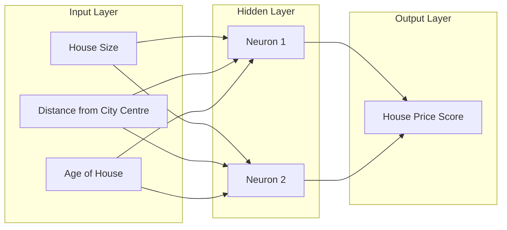

# House Price Estimation Using Matrix Multiplication

A Mathematics for AI lab micro-project demonstrating how matrix multiplication and neural network operations can be used for house price estimation.

## Problem Statement

The objective is to calculate a house price score using three input features:

- **House size:** Measured in units of 100 sq. ft.
- **Distance from city centre:** Represents the house location.
- **Age of the house:** Represents how old the property is.

## Neural Network Architecture

The model uses three input features, two hidden neurons and one output neuron.

## Mathematical Approach

The calculation follows these steps:

1. Represent the three input features as an input vector.
2. Multiply the input vector by the hidden-layer weight matrix.
3. Add the hidden-layer bias values.
4. Apply the ReLU activation function to the hidden-layer output.
5. Multiply the hidden-layer output by the output-layer weights.
6. Add the output-layer bias to calculate the final score.

### Key Concepts Used

- Matrix multiplication
- Weight matrices and bias values
- ReLU (Rectified Linear Unit) activation
- Input, hidden and output layers
- Neural network computation

## Python Implementation

The model was implemented using **Python and NumPy**.

The implementation includes:

- A ReLU activation function.
- A function to calculate the hidden-layer output.
- A function to calculate the final output.
- Step-by-step display of mathematical calculations.

## Result

**Predicted House Price Score: 3.5200**

This is the output score calculated by the model for the given sample input. It is not presented as a real-world price in any particular currency.

## What I Learned

Through this exercise, I explored:

- How input features can be represented using vectors.
- How matrix multiplication is used in neural network calculations.
- How weights and biases affect the output.
- How ReLU activation is applied in a hidden layer.
- How multiple mathematical operations combine to produce a model output.

## Project Documentation

The submitted report contains the mathematical calculations, Python implementation, output and supporting explanation.

[View the House Price Estimation Project Report (PDF)](./MAI-Project.pdf)

---

**Course:** Mathematics for AI  
**Session:** 3 - Modelling a Single-Layer Neural Network Using Matrix Multiplication  
**Case Study:** House Price Estimation